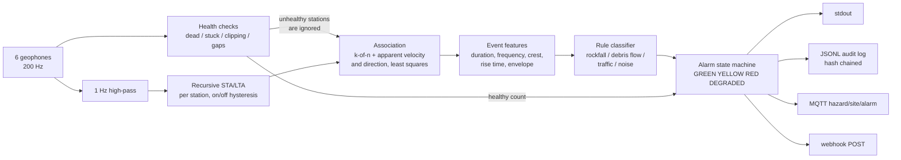

# rockfall-geophone-alarm

A small, runnable model of a **multi-station geophone alarm chain** for rockfall and debris-flow
monitoring on a slope: from raw seismic samples to a traffic-light decision (close the road or not),
with an audit trail.

It runs entirely on **synthetic signals**. There is no real data in this repo, and it is **not a safety
system** (see [Honest limits](#honest-limits)).

## Why

Alarm chains for natural hazards are mostly an exercise in reliability engineering, not in clever
signal processing:

- How long does it take from the first ground motion to a red light, and where does the time go?
- How many false closures per year can you accept, and how many missed events?
- What happens when a sensor dies, saturates or freezes? An alarm system that quietly goes blind and
  keeps showing green is worse than none.

This repo makes those questions concrete and testable: every stage is small, typed, and configurable,
the classifier is a list of readable rules (no black box), and a benchmark reports the trade-offs.

## Architecture



| Module | What it does |
|---|---|
| `rockfall/sim/` | Synthetic generator: rockfall (impulsive impacts moving downslope), debris flow (long emergent low-frequency rumble moving at a few m/s), traffic (narrowband engine harmonics on the road, about 15 m/s), wind gusts, distant quakes, animal footsteps, plus faults (dead, stuck, clipping station). Scripted scenarios carry ground truth. |
| `detect/sta_lta.py` | Recursive STA/LTA with on/off thresholds. The LTA is frozen while triggered, otherwise a long rumble drags it up and the trigger drops out mid-event. Formula in the docstring. |
| `detect/associate.py` | k-of-n coincidence in a time window; least-squares fit of arrival times for apparent speed and direction; outlier stations are dropped by subset search. Causal: an event exists from the moment the k-th station fires. |
| `detect/features.py` | Duration, peak amplitude, dominant frequency, spectral centroid, peakiness, rise time, crest factor, envelope variation. |
| `detect/classify.py` | Ordered rules from `rockfall/config/default.json`, each one documented, each check reported. |
| `detect/health.py` | Dead, stuck, clipping, data gaps. |
| `alarm.py` | State machine with hold times, optional manual acknowledgement, DEGRADED state. |
| `sinks.py` | stdout, hash-chained JSONL audit log, optional MQTT, optional webhook. A failing sink never stops the alarm. |
| `bench.py` | Randomised scenarios, confusion matrix, false alarms per simulated day, misses, latency. |

## Quickstart

```bash
python -m venv .venv
.venv/Scripts/activate            # Windows;  source .venv/bin/activate  on Linux/macOS
pip install -r requirements-dev.txt

python -m pytest -q
python -m rockfall simulate --scenario rockfall
python -m rockfall simulate --scenario debrisflow --audit-log audit.jsonl
python -m rockfall simulate --scenario mixed
python -m rockfall simulate --scenario dead-station
python -m rockfall simulate --scenario degraded
python -m rockfall bench --n 200 --seed 1
```

Scenarios: `rockfall`, `debrisflow`, `traffic`, `mixed`, `dead-station` (one dead and one clipping
station, a rockfall must still be caught), `degraded` (half the network fails, the system must say so).
Extras: `--require-ack --ack-at 600`, `--mqtt host:1883` (needs `paho-mqtt`), `--webhook URL`.

### Sample output

```
$ python -m rockfall simulate --scenario debrisflow --seed 1 --audit-log audit.jsonl
[     0.0s]    GREEN -> DEGRADED light=yellow_flashing road_closed=False  start-up: waiting for first health check
[    12.6s] DEGRADED -> GREEN    light=green           road_closed=False  start-up health check passed
[    84.1s]    GREEN -> YELLOW   light=yellow          road_closed=False  event 1: coincident downslope trigger on 6 stations
[   105.1s]   YELLOW -> RED      light=red             road_closed=True   event 1: debris_flow (debris_flow via 'debris_flow': duration_s=29.9 in [25.0, inf]; centroid_hz=9.36 ...
[   405.1s]      RED -> GREEN    light=green           road_closed=False  red hold elapsed

scenario 'debrisflow' seed=1 duration=216s
  truth: debrisflow    70.0s -   185.5s
associated events (1):
  #1 t=   72.6s stations=G1,G2,G3,G4,G5,G6 speed=7m/s cos_downslope=+1.00 -> debris_flow [debris_flow]
```

The system starts in DEGRADED and only turns GREEN after the first health check passes. Every transition
in the audit log carries the event, the rule that fired, and a latency breakdown, for example for a rockfall:

```json
"latency": {"association_wait": 0.59, "classification_window": 11.0, "acquisition_block": 1.0,
            "telemetry": 0.5, "processing": 0.1, "actuation": 1.0, "total_after_first_trigger": 14.19}
```

## Reliability design

**Latency budget.** Time to RED = trigger on the k-th station + classification window + fixed overhead
(acquisition block 1.0 s, telemetry 0.5 s, processing 0.1 s, actuation 1.0 s, all in the config). The
classifier waits for a short window of signal before it commits (6 s, retried every 5 s while the event
is still running, up to 60 s). That wait is the price of not closing the road for every truck. The
budgets in the config (30 s rockfall, 90 s debris flow) are checked per scenario in `bench`.

**False alarms vs misses.** Every threshold sits in one JSON file. Raising the STA/LTA on-threshold or
`min_stations` removes false alarms and misses small events; the benchmark prints detection rate by
rockfall size so the cost is visible.

**Station health and fail-safe behaviour.**
- A window of raw data is checked every 10 s: dead (flat), stuck (repeated values), clipping (at the ADC
  rail), data gap. Unhealthy stations are excluded from association.
- If fewer than `min_healthy_stations` (4 of 6) are healthy, the state becomes **DEGRADED**: flashing
  yellow plus an operator notification; whether DEGRADED also closes the road is a site policy flag
  (`degraded_closes_road`).
- The machine **starts** in DEGRADED and only leaves it after a passing health check; it leaves
  DEGRADED again only after 60 s of continuous health.
- Precedence is RED > DEGRADED > YELLOW > GREEN. A hazard still shows RED while degraded, and when the
  RED hold ends the state falls back to DEGRADED, never to GREEN.
- RED returns to GREEN only after the hold time (300 s) and, if `require_ack` is set, an operator
  acknowledgement. New evidence extends the hold and cancels an early ack.
- Sinks are best effort. A dead MQTT broker or webhook is logged and does not stop the alarm.
- The audit log is append-only JSONL where every line includes the SHA-256 of the previous line, so
  edits, deletions and reordering are detectable (`verify_audit_log`).

## Classifier rules

Evaluated top to bottom, first full match wins. All thresholds are in `rockfall/config/default.json`.

| Rule | Label | Reading |
|---|---|---|
| `traffic` | traffic | Narrowband (peakiness >= 12), dominant 6-45 Hz, 5-60 s, smooth envelope. Engine harmonics. |
| `debris_flow` | debris_flow | >= 25 s, centroid <= 20 Hz, steady envelope, front moving downslope at 1-12 m/s. |
| `rockfall_moving` | rockfall | 1-40 s, crest factor >= 6, bursty, broadband, centroid >= 20 Hz, front moving downslope at 5-150 m/s. |
| `rockfall_impact` | rockfall | Same shape, stricter, but onsets arrive almost together (>= 150 m/s). A big impact is heard by the whole array at seismic speed. |
| `simultaneous` | noise | Near-simultaneous onset that is not impulsive enough: wind, quakes, interference. |

No rule matching gives `unclassified`: the event stays a YELLOW candidate, it is never silently dropped.
Output includes the numeric check for every condition (`result.explain()`).

## Benchmark

`python -m rockfall bench --n 200 --seed 1` (about 30 s). 200 randomised scenarios: random event
sizes, speeds, noise levels, 20 % of hazards with a coincident wind gust, 10 % with a dead station.

```
scenarios: 200   wall time: 28s

Confusion matrix (rows = truth, columns = classifier verdict of the event chain)
                  rockfall   debris_flow       traffic         noise  unclassified          none
    rockfall            33             0             1             0             9             0
  debrisflow             0            23             0             0             0             0
     traffic             0             0            28             0             0            13
        wind             0             0             4            22             3             0
      animal             0             0             0             0             0            18
       quake             0             0             0            25             0             0
       quiet             0             0             0             0             0            21

   rockfall: detected 33/43  missed 10  onset->RED latency p50 14.0s  p95 19.1s  max 19.8s  within budget 33/33
 debrisflow: detected 23/23  missed 0  onset->RED latency p50 36.6s  p95 53.8s  max 92.3s  within budget 22/23
all hazards: onset->RED latency p50 16.3s  p95 40.3s
rockfall detection by median impact amplitude (counts; noise sigma ~1): <30: 2/7  30-100: 15/20  100-300: 14/14  >300: 2/2

non-hazard simulated time: 15.1 h (0.627 day)
false RED   : 0  ->  0.0 per simulated day (resolution: 1 event = 1.6/day)
false YELLOW: 4  ->  6.4 per simulated day
fail-safe violations (>= half the stations faulty yet final state GREEN): 0
```

How to read it:

- Rows are what really happened, columns what the chain concluded. `none` means no station group
  associated at all (traffic seen by one or two stations, a footstep at one station), which is the
  intended outcome for non-hazards. The 10 missed rockfalls are all small ones, in the lowest
  two amplitude bins (see the size line), a direct consequence of the STA/LTA threshold and the 3-of-6 requirement.
- Latency is measured from the first physical ground motion to the RED decision, overhead included.
  Debris flows are slower because the front has to reach three stations and the rumble must be long enough
  to look like a flow.
- The false-alarm rate has poor resolution: 15 simulated hours is far too short to claim anything about
  rare events. Treat 0 as "none seen", not as "never".
- **This benchmark is optimistic.** The thresholds were set by hand against the same generator that
  produces the test data. Real ground is messier. The numbers show the machinery works and what the
  trade-off knobs do, not what a deployed system would achieve.

## Honest limits

- **Synthetic signals only.** Amplitude, attenuation, wave speed and source models are toy models.
  Thresholds are **not calibrated on real data**.
- Real systems combine several independent sensing principles (radar, cameras, infrasound, geophones,
  ground-based sensors in the flow channel) and often a human or a second detector before closing a
  route. This repo has geophones only and no second opinion.
- The array is a simplified gully: 6 stations, 1-D geometry, a single propagation speed, no topography,
  no site effects, no real noise sources (rivers, machinery, helicopters).
- The velocity/direction estimate uses trigger-on times. With a narrow array the cross-slope direction
  cannot be resolved, so the demo site uses an along-slope fit.
- Latency is computed from event time stamps plus configured overheads; it is not measured over a real
  network.
- **This is not a certified safety system. Never use it for real road or rail closures.**

## Next steps

- Replace the generator with real geophone records from public seismic archives (FDSN web services:
  rockfall and debris-flow catalogues with station metadata) and calibrate thresholds by ROC analysis,
  keeping a held-out set.
- Station telemetry for the field: LoRa or LTE-M uplinks with sequence numbers, store-and-forward and
  heartbeat monitoring, so a silent station counts as unhealthy.
- Camera confirmation: a second, independent sensor to turn YELLOW into RED, or to cancel a RED, before
  an automatic closure.
- Two-dimensional arrays and proper source location (grid search over a velocity model) instead of
  trigger-on times.
- Streaming mode over a live MQTT feed instead of replay.

## Layout

```
rockfall/            package (sim/, detect/, alarm.py, sinks.py, pipeline.py, bench.py, cli.py, config/)
tests/               pytest suite (STA/LTA, association, classifier rules, health, state machine, sinks, end to end)
.github/workflows/   CI (Ubuntu, Python 3.11)
```

MIT licensed, see `LICENSE`.
